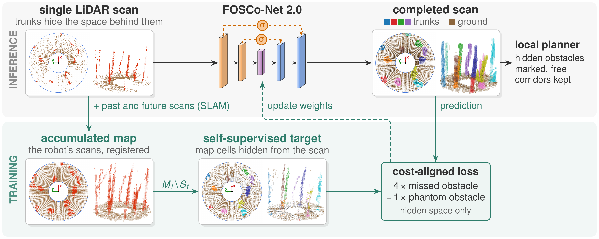
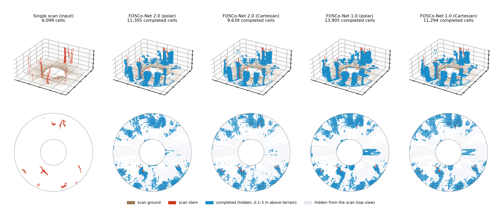
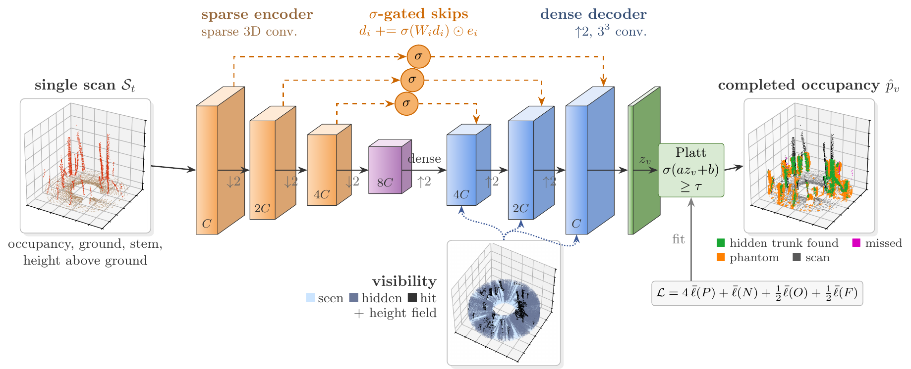
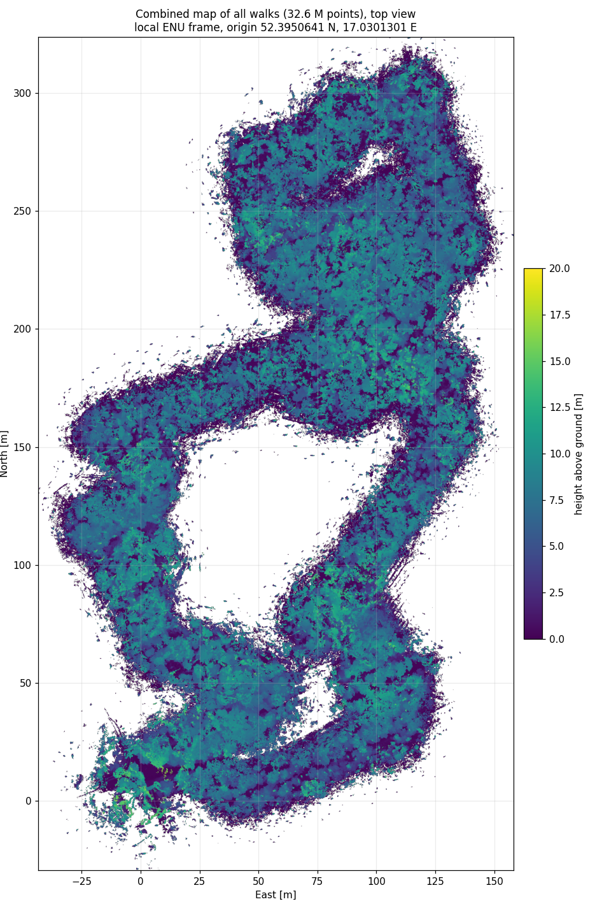

# FOSCo-Net

**Completion of trunk-occluded geometry in single forest LiDAR scans, for ground-robot planning.**

In a forest, the trunks closest to a ground robot hide wide sectors of its LiDAR view, and the hidden space holds
exactly the obstacles a local planner has to reason about. FOSCo-Net (Forest Occlusion Scan Completion Network)
predicts the occupancy of this hidden space from a single scan. It is trained self-supervised on maps accumulated
from the robot's own recordings, and its objective and calibration weigh a missed obstacle four times a phantom one,
as a planner pays for them.

This repository contains the networks, the published weights of FOSCo-Net 2.0 and 1.0, and a complete pipeline
from the recordings of the forest walks dataset to completed scans.



## Contents

- [Installation](#installation)
- [Quick start](#quick-start)
- [Pipeline](#pipeline)
- [Models](#models)
- [Python API](#python-api)
- [Dataset](#dataset)
- [Output files](#output-files)
- [Citation](#citation)
- [Licence](#licence)

## Installation

Requirements: Linux, Python 3.9 or newer, an NVIDIA GPU with CUDA, and PyTorch 2.

```bash
git clone https://github.com/iman01/fosconet.git
cd fosconet
pip install -e .
pip install spconv-cu124          # the spconv build of your CUDA version: cu118, cu120, cu121, cu124, ...
```

Labelling the scans (`fosconet prepare` and `fosconet run`) also needs
[MinkowskiEngine](https://github.com/NVIDIA/MinkowskiEngine), which runs the pretrained DigiForests segmentation
network. Building it for a recent PyTorch takes a few steps, described in [docs/INSTALL.md](docs/INSTALL.md).
Prediction on scans that are already labelled (`fosconet predict`) needs spconv only.

## Quick start

```bash
fosconet download sample --out data           # 60 s excerpt of the dataset (part of the 2.1 GB companion archive)
fosconet download segmenter                    # pretrained DigiForests forest_pan_seg network (9.7 MB)
fosconet run data/companion/sample/walks_2026-08-12_sample60s --out results --every 20 --figures 3
```

`results/` then holds one input sample per second of the recording (`samples/`), the completions of FOSCo-Net 2.0
and 1.0 (`predictions/`) and figures of the first three scans (`figures/`). Add `--ply` for coloured point clouds
in the map frame and `--map data/companion/map/walks_2026-08-12_map_local_enu.pcd` to show the map of all walks
next to the predictions.



*One scan of the sample recording completed by the four published models. Top: 3D view, bottom: top view of the
layer 0.1-3 m above the terrain, with the space hidden from the scan in light grey. Blue: hidden cells predicted
occupied. The FOSCo-Net 1.0 models add phantom blocks in open hidden space (right of the sensor).*

## Pipeline

| Step | Command | What happens |
|---|---|---|
| Read | `prepare` | LiDAR scans, trajectory and static transforms are read from the bag without ROS (`rosbags`). Every 3rd point of the raw scan is kept, the density of the training scans. |
| Ego frame | `prepare` | Each scan is deskewed along the trajectory and placed in a gravity-levelled ego frame (origin at the LiDAR, z from the Xsens AHRS, x along the rig's heading). Points of the operator within 1.2 m are removed. |
| Labels | `prepare` | The DigiForests network segments windows of 9 scans in the map frame. Each scan's points take the class voted over the windows of the past 5 s, as a robot would have them while driving. Only ground and stem cells enter the grids. |
| Grids | `prepare` | Ground and stem cells on the polar grid (40 x 360 x 250 cells: 2-6 m in 0.1 m, 1 deg, -5 to 20 m in 0.1 m) and/or the Cartesian grid (120 x 120 x 250 cells of 0.1 m). |
| Visibility | `prepare` | A depth image of the scan labels every cell as seen (observed empty), hit or hidden. |
| Completion | `predict` | The network predicts the occupancy of every cell; FOSCo-Net 2.0 is Platt-calibrated and thresholded at its validation threshold. |
| Figures | `render` | 3D views and top views of input, predictions and the optional map reference. |



*FOSCo-Net 2.0. A sparse encoder processes the occupied cells of the scan, and a dense decoder restores the grid,
receiving the encoder features through sigmoid-gated skips and the scan's visibility and height field at every
stage.*

## Models

| Model | Grid | Inputs | Threshold | Score in-domain | Score held out | False blocking held out | Collision held out | Time per scan |
|---|---|---|---|---|---|---|---|---|
| `fosconet2-cart` | Cartesian | cells, labels, height, visibility | 0.35 | 0.539 | **0.456** | 0.197 | 0.136 | 0.060 s |
| `fosconet2-polar` | polar | cells, labels, height, visibility | 0.35 | 0.552 | 0.468 | 0.226 | 0.154 | 0.080 s |
| `fosconet1-cart` | Cartesian | cells, labels | 0.5 | 0.513 | 0.650 | 0.699 | 0.033 | |
| `fosconet1-polar` | polar | cells, labels | 0.5 | 0.528 | 0.527 | 0.617 | 0.068 | |

The score is the cost-weighted error 4 x FFR + FOR on hidden space (lower is better), where FFR is the share of
hidden trunk volume predicted free and FOR the share of hidden free volume predicted occupied. False blocking is the
share of truly free robot positions the completed map blocks, collision the share of positions next to a hidden
obstacle that it leaves free (both averaged over robot radii of 0.1-1.0 m). In-domain: 131 test scans from the five
training datasets, held out: 288 scans from seven datasets never seen in training. For comparison, the best of 22
published methods (ConvONet, retrained) scores 0.596 in-domain and 0.535 held out. Times on an NVIDIA RTX 4090
Laptop GPU.

- **FOSCo-Net 2.0** (this repository's default) is the model of the journal article: cost-aligned objective with
  Platt calibration, visibility input, height above the terrain, seam-free cylindrical encoder and sensor
  augmentation, trained on 619 scans of five forest datasets.
- **FOSCo-Net 1.0** is the model of the conference paper (focal loss, uncalibrated, no visibility or height input),
  retrained on the same data. It is not distinguishable from 2.0 in-domain, but blocks most free hidden space and
  generalises worse to unseen forests.

The weights are in `fosconet/weights/` (7.3 MB each).

## Python API

```python
from fosconet.bag import Recording
from fosconet.segment import Segmenter
from fosconet.pipeline import prepare
from fosconet.predict import Predictor

rec = Recording('data/companion/sample/walks_2026-08-12_sample60s')
model = Predictor('fosconet2-polar')
for sample in prepare(rec, Segmenter('~/.cache/fosconet/forest_pan_seg_model.ckpt'), grids=('polar',), every=20):
    coords, labels = sample.cells['polar']
    vis = sample.vis['polar']
    out = model(coords, labels, vis)
    completed = out.completed_cells(vis['hidden'])     # (M, 3) cells hidden from the scan and predicted occupied
```

The networks work on any LiDAR scan given in a gravity-levelled frame with ground and stem labels:
`fosconet.grid.voxelize` builds the cells, `fosconet.visibility.trace` the visibility, and `Predictor` completes them.

## Dataset

The forest walks dataset holds about one hour of handheld recordings (Ouster OS0-64 LiDAR, Xsens MTi-30 IMU,
u-blox ZED-F9P GNSS) of a mixed temperate forest, registered into one trajectory and map. It is published on
Zenodo under CC BY 4.0 in two parts:

| Part | Content | DOI |
|---|---|---|
| 1 | four walks, 33 min, 33,540 scans, 37.6 GB | [10.5281/zenodo.24378952](https://doi.org/10.5281/zenodo.24378952) |
| 2 | one walk, 30 min, 36,013 scans, 39.3 GB | [10.5281/zenodo.24378954](https://doi.org/10.5281/zenodo.24378954) |

Both records also contain a companion archive with the joint map, the trajectory, the topic descriptions and a
60 s sample bag. `fosconet download part1` (or `part2`) fetches a full part and checks every file against its
checksum.



## Output files

**Sample** (`prepare`, one `.npz` per scan): `index`, `stamp` (scan start, s), `T_map_ego` (4 x 4 pose of the ego
frame in the map), and per grid `<grid>_coords` (M x 3 cell indices), `<grid>_labels` (1 ground, 3 stem) and the
bit-packed visibility `<grid>_vis_seen`, `<grid>_vis_hit`, `<grid>_vis_margin` (hidden = none of them). With
`--keep-points` also the labelled points (`xyz`, `labels`).

**Prediction** (`predict`, one `.npz` per scan and model): `model`, `grid`, `threshold`, `coords` and `prob` of
every cell with probability of at least 0.05, the scan cells, the hidden mask and the estimated terrain height per
column. `fosconet.io.Prediction` reads it, and `Prediction.completed()` returns the hidden cells predicted occupied.

Cell indices are `(r, theta, z)` on the polar grid and `(x, y, z)` on the Cartesian grid; `fosconet.grid.centres`
converts them to metres in the ego frame.

## Citation

If you use the code, the models or the dataset, please cite the journal article (under review; its reference will
be added here) and the conference paper:

```bibtex
@misc{esfandiyar2026fosco,
  author        = {Esfandiyar, Iman and Belter, Dominik},
  title         = {{FOSCo-Net}: Ego-centric Voxel Completion for Forest {LiDAR} Occlusions},
  year          = {2026},
  eprint        = {2611.06588},
  archivePrefix = {arXiv},
  doi           = {10.48550/arXiv.2611.06588},
}
```

The dataset: Esfandiyar, I. and Belter, D. (2026). Forest walks 2026-08-12 (parts 1 and 2). Zenodo.
doi:10.5281/zenodo.24378952, doi:10.5281/zenodo.24378954.

## Licence

The code is released under the MIT licence ([LICENSE](LICENSE)). The model weights are released under the terms in
[fosconet/weights/LICENSE](fosconet/weights/LICENSE). The segmentation network files in
`fosconet/third_party/digiforests` come from the DigiForests devkit ([dataset page](https://www.ipb.uni-bonn.de/data/digiforest-dataset/))
(MIT licence, Malladi et al., 2025); the pretrained segmentation checkpoint is downloaded from its authors.

## Acknowledgements

This work was supported by the Polish Ministry of Science and Higher Education under the Applied Doctorate
Programme, 2024-2028 (grant DWD/8/0080/2024). Institute of Robotics and Machine Intelligence, Poznań University of
Technology, and Łukasiewicz Research Network - Poznań Institute of Technology.
